<div align="center">

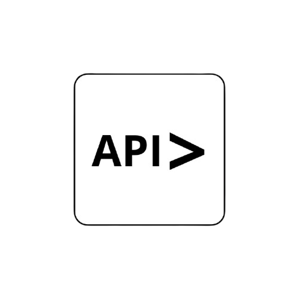

# API Desk

**A fast, modern, open source API client that runs in your browser.**

Build, send and save HTTP requests. Organise them in collections, share variables and headers across a whole collection, and read every response at a glance. No installation needed.

[](https://github.com/MilanSirko/api-desk/actions)
[](LICENSE)
[](CONTRIBUTING.md)
[](https://www.python.org/)
[](https://fastapi.tiangolo.com/)
[](https://supabase.com/)
[](https://api-desk-website.vercel.app/)

[Live app](https://api-desk-website.vercel.app/) ·
[Docs](https://api-desk-website.vercel.app/docs.html) ·
[Report a bug](https://github.com/MilanSirko/api-desk/issues/new) ·
[Request a feature](https://github.com/MilanSirko/api-desk/issues/new)

</div>

---

<p align="center">
  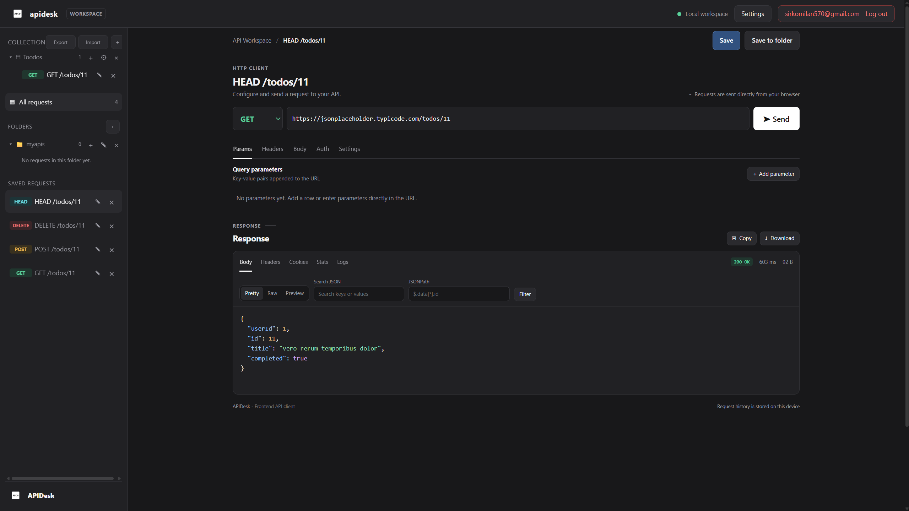
</p>

## Why API Desk?

- **Zero setup.** Open the workspace, paste a URL, press Send.
- **Organised.** Collections, folders and saved requests keep everything in one place.
- **Clear responses.** Body, headers, cookies, stats and request logs, each in its own tab.
- **Shared settings.** Define variables, headers and auth once per collection and reuse them in every request.
- **Open source and self-hostable.** Read the code, run your own copy, contribute.
- **Privacy-minded.** Authentication secrets are not saved with your requests.

## Send your first request

1. Open the workspace.
2. Pick a method and enter a URL, for example `https://jsonplaceholder.typicode.com/todos/1`.
3. Press **Send** and read the response.

<p align="center">
  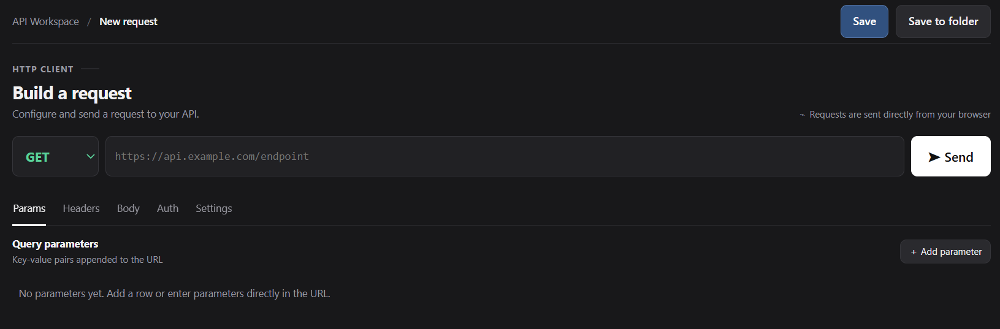
</p>

## Features

### Build requests

- Methods: `GET`, `POST`, `PUT`, `PATCH`, `DELETE`, `HEAD`, `OPTIONS`
- Query parameters and headers as tables, with rows you can switch on and off
- Body types: JSON, URL-encoded, raw text and GraphQL
- Authentication: Bearer token, Basic and API key
- Request settings: timeout, retries with a delay, redirect following and a maximum response size

<table>
  <tr>
    <td width="50%">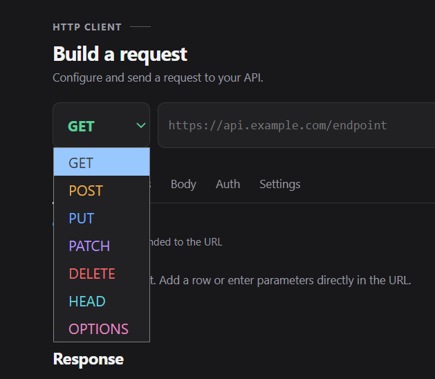<br><sub>Every common HTTP method</sub></td>
    <td width="50%">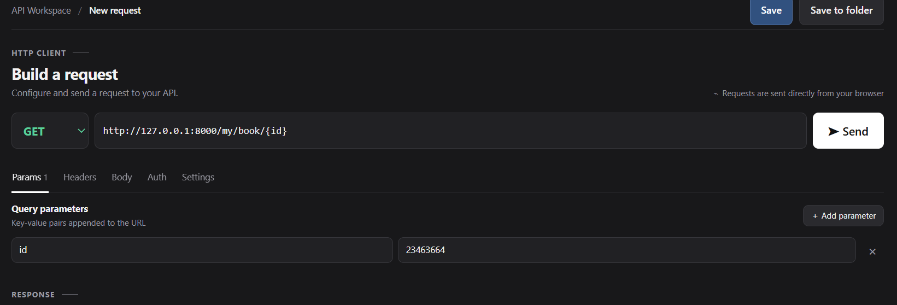<br><sub>Query parameters as a table</sub></td>
  </tr>
  <tr>
    <td width="50%">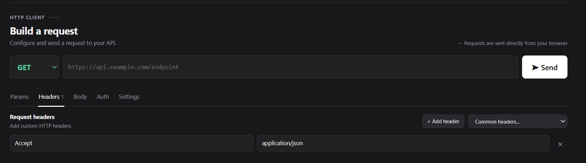<br><sub>Headers you can switch on and off</sub></td>
    <td width="50%">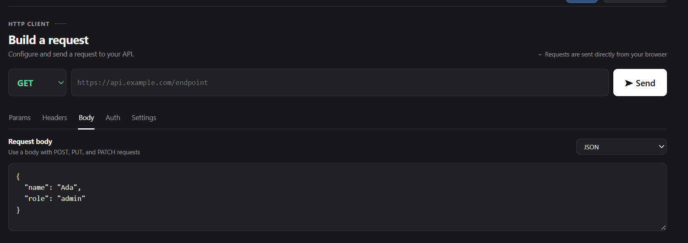<br><sub>JSON, URL-encoded, raw and GraphQL bodies</sub></td>
  </tr>
  <tr>
    <td width="50%">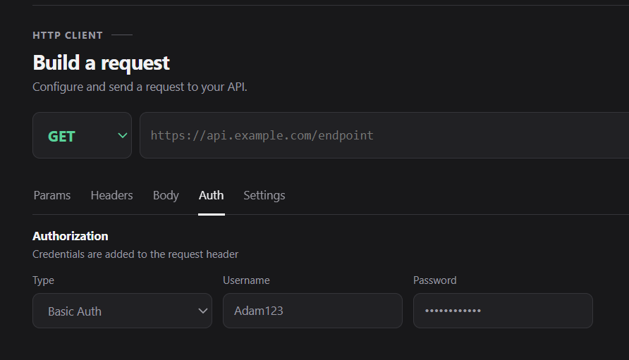<br><sub>Bearer, Basic and API key authentication</sub></td>
    <td width="50%"><br><sub>Timeout, retries, redirects and response size limit</sub></td>
  </tr>
</table>

### Read responses

- Formatted JSON and raw body
- Response headers and cookies
- **Stats** tab with status, response time, size and JSON structure
- **Logs** tab with a terminal view of every request you sent

<table>
  <tr>
    <td width="50%">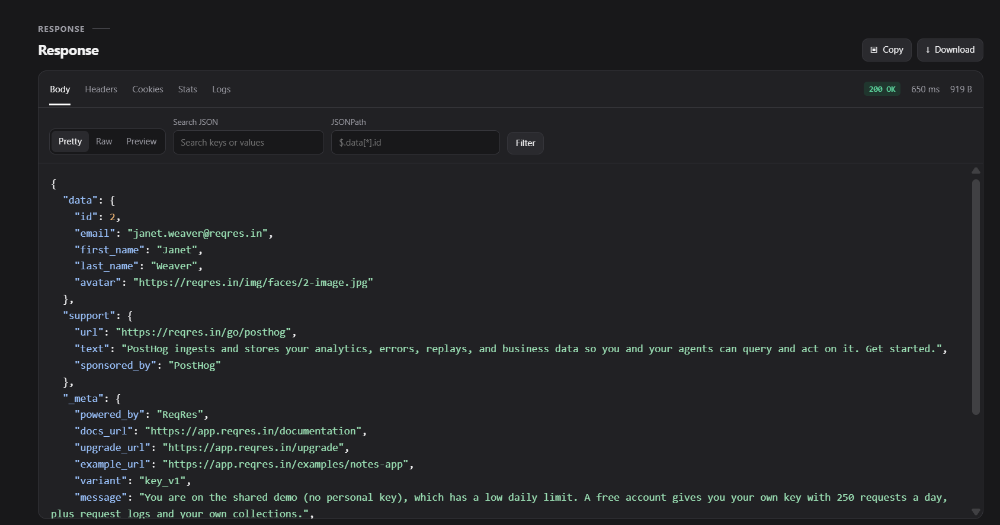<br><sub>Body: formatted JSON</sub></td>
    <td width="50%">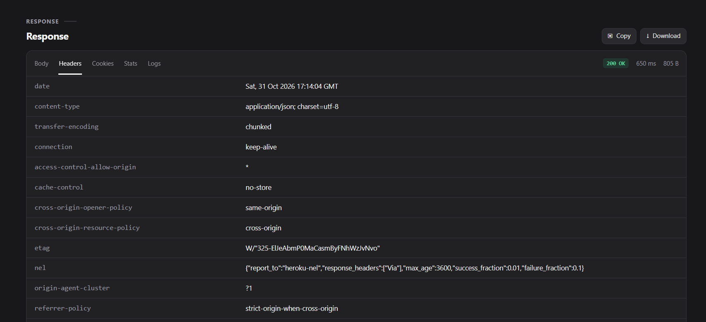<br><sub>Headers: every response header</sub></td>
  </tr>
  <tr>
    <td width="50%">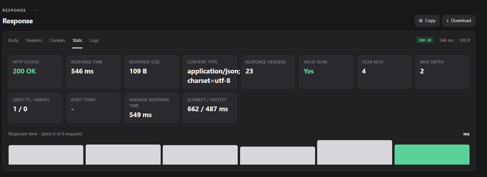<br><sub>Stats: status, timing, size and structure</sub></td>
    <td width="50%">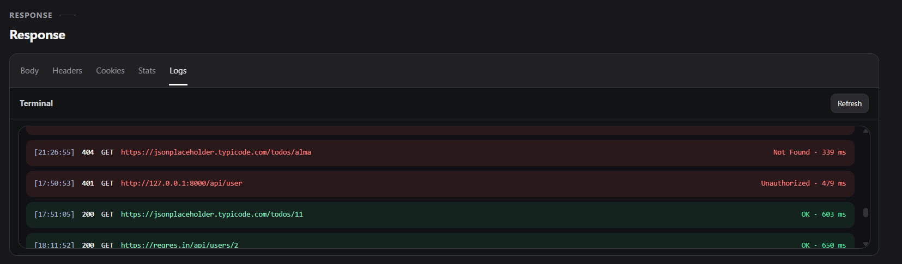<br><sub>Logs: a terminal view of every request</sub></td>
  </tr>
</table>

### Organise

- Collections and folders
- Save a request, save it to a folder, copy it into a collection
- Export and import

### Share settings across a collection

- Variables, used as `{{variable_name}}` in URLs, params, headers and bodies
- Shared headers
- Shared authorization
- Shared request settings
- A request's own value always wins over the collection's

<table>
  <tr>
    <td width="50%" align="center"><br><sub>Collections, folders and saved requests</sub></td>
    <td width="50%" align="center">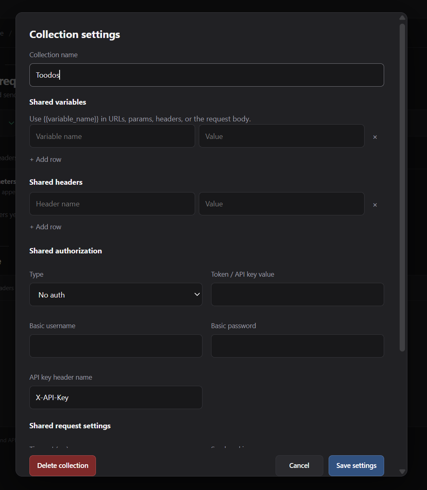<br><sub>Shared variables, headers and request settings</sub></td>
  </tr>
</table>

### Accounts and your data

- Email and password sign-up with email confirmation
- Sign in with Google or GitHub
- Delete your account and all of your data at any time

<table>
  <tr>
    <td width="50%" align="center">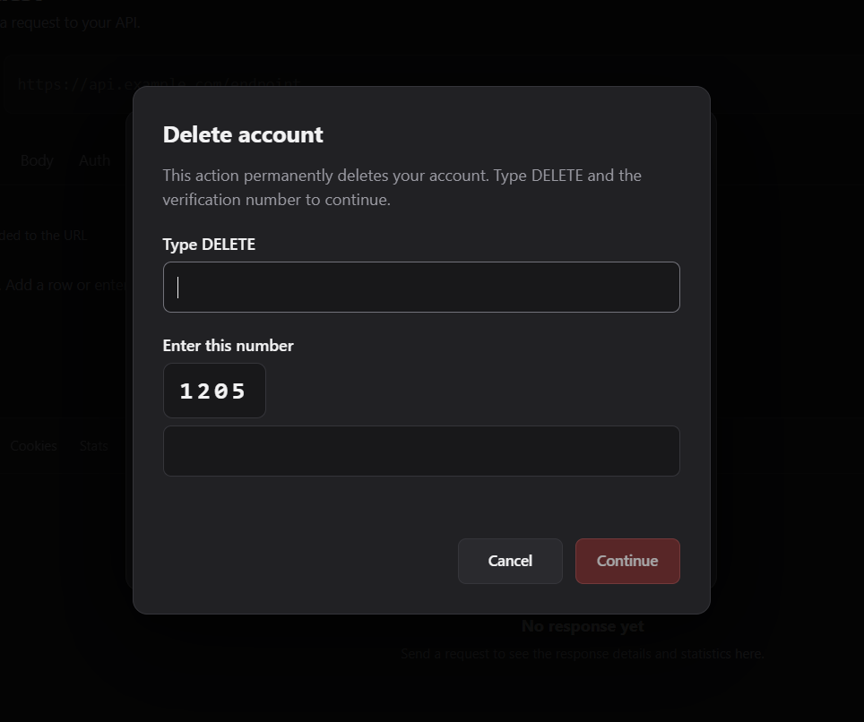<br><sub>Delete your account and all of your data</sub></td>
    <td width="50%" align="center">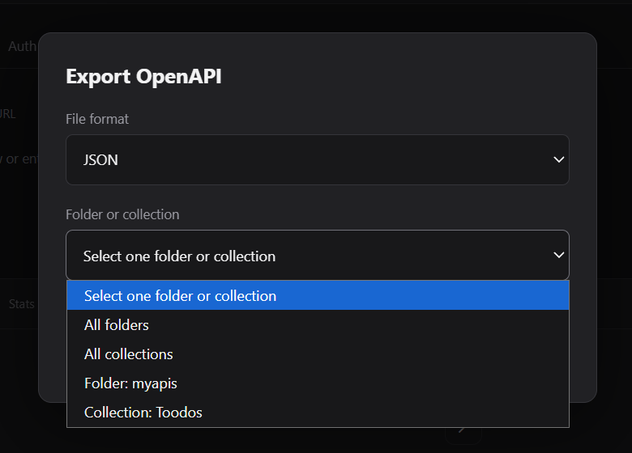<br><sub>Export and import your collections</sub></td>
  </tr>
</table>

## How it works

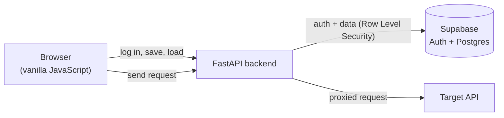

The frontend is a static site. The backend authenticates the user with Supabase, stores collections and requests in Postgres, and sends your HTTP requests to the target API on your behalf.

## Tech stack

| Layer | Technology |
|---|---|
| Frontend | HTML, CSS, vanilla JavaScript (hosted on Vercel) |
| Backend | Python 3.11, FastAPI, httpx, slowapi (hosted on Render) |
| Database and auth | Supabase: Postgres, Row Level Security, Auth |
| Email | any SMTP provider |

## Getting started

### Use the hosted version

Open **[API Desk](https://api-desk-website.vercel.app/index.html)**, sign up and go to the workspace.

### Run it yourself

**Requirements:** Python 3.11+, Git and a [Supabase](https://supabase.com/) project (the free plan is enough for development).

**1. Clone the repository**

```bash
git clone https://github.com/YOUR_USERNAME/api-desk.git
cd api-desk
```

**2. Set up Supabase**

1. Create a new project.
2. Open the SQL Editor and run the files in `supabase/migrations/` in order.
3. Go to Authentication and enable email sign-in. Google and GitHub are optional.
4. Under URL Configuration add your local URLs, for example `http://127.0.0.1:5500` as the Site URL and `http://127.0.0.1:8000/api/auth/callback` as a Redirect URL.

**3. Start the backend**

```bash
cd backend
python -m venv .venv
source .venv/bin/activate        # Windows: .venv\Scripts\activate
pip install -r requirements.txt
cp .env.example .env             # then fill in the values below
uvicorn backend:app --reload
```

| Variable | Description |
|---|---|
| `SUPABASE_URL` | Your project URL, `https://<ref>.supabase.co` |
| `SUPABASE_ANON_KEY` | The publishable (anon) key |
| `SUPABASE_SERVICE_KEY` | The secret (service role) key. **Server only, never expose it.** |
| `FRONTEND_URL` | Where the frontend runs, for example `http://127.0.0.1:5500` |
| `API_URL` | Where the backend runs, for example `http://127.0.0.1:8000` |
| `ALLOWED_ORIGINS` | Comma-separated list of allowed frontend origins (CORS) |
| `ENV` | `dev` or `prod` (`prod` turns the API docs off) |

**4. Start the frontend**

```bash
cd frontend
python -m http.server 5500
```

Open <http://127.0.0.1:5500>. Use the same host name (`127.0.0.1` or `localhost`) everywhere, otherwise the browser treats them as different origins.

## Deployment

- **Backend:** any host that runs Python. Example start command: `uvicorn backend:app --host 0.0.0.0 --port $PORT --proxy-headers --forwarded-allow-ips='*'`
- **Frontend:** any static host. Set the API address in `frontend/config.js`.
- Set the same environment variables as above in your host's dashboard. Never commit a `.env` file.

## Project structure

```
api-desk/
├── backend/            FastAPI app, auth, request proxy
├── frontend/           static site: landing page and workspace
├── supabase/
│   └── migrations/     database schema, policies, limits
├── docs/               documentation
├── website/assets/     brand files and screenshots
├── CONTRIBUTING.md
├── SECURITY.md
└── LICENSE
```

## Security

- Row Level Security is enabled on every table, so users can only read and change their own data.
- The Supabase service key is used only on the server.
- Authentication secrets are not saved with requests.
- Requests are rate limited, and response size, timeout and retry values have upper limits.

Found a vulnerability? Please do not open a public issue. Follow [SECURITY.md](SECURITY.md).

## Roadmap

- [x] Requests, responses, collections and folders
- [x] Shared collection settings
- [x] Email, Google and GitHub sign-in
- [ ] Environments (switch between dev and prod variables)
- [ ] cURL import and export, code generation
- [ ] Request history
- [ ] Postman collection and OpenAPI import
- [ ] Assertions and a collection runner
- [ ] Password reset
- [ ] Team workspaces

Have an idea? [Open an issue](https://github.com/YOUR_USERNAME/api-desk/issues/new).

## Contributing

Contributions are welcome. Read [CONTRIBUTING.md](CONTRIBUTING.md) first, then pick an issue labelled `good first issue`, or open one to discuss your idea.

## License

Released under the [MIT License](LICENSE).

## Acknowledgements

Built with [FastAPI](https://fastapi.tiangolo.com/), [httpx](https://www.python-httpx.org/), [slowapi](https://github.com/laurentS/slowapi) and [Supabase](https://supabase.com/).
